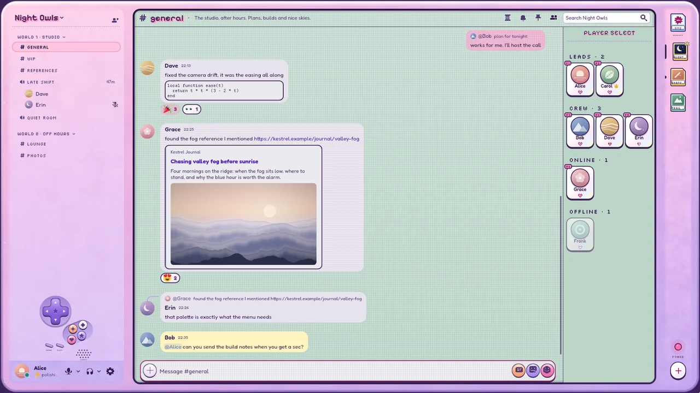

# Bubblegum

A theme for [Yapfast](https://github.com/yapfast/yapfast).

A pastel handheld console of our own design: a pink-to-lilac plastic shell with a star D-pad, candy face keys, a power LED and speaker slots, a mint LCD inset in a plum bezel with a pixel grid, candy hover bar, holographic player cards, chunky pixel icons and 8-bit blips. Light only.

## Install

- In Yapfast, open **Settings > Appearance > Themes**, find **Bubblegum** in the marketplace and install it.
- Or paste this repository's URL (`https://github.com/yapfast-themes/bubblegum`) into **Settings > Appearance > Themes > Add from URL**.

## Credits

Art and sounds: original work for this theme (CC0). Pixel icons redrawn from Solar by 480 Design (CC BY 4.0) and Lucide (ISC). Fonts: Fredoka, Silkscreen, Pixelify Sans and Departure Mono (SIL OFL 1.1).

Full terms are in [LICENSE](LICENSE) (CC0-1.0 AND OFL-1.1 AND CC-BY-4.0 AND ISC); each font's licence sits beside it in `fonts/`.
