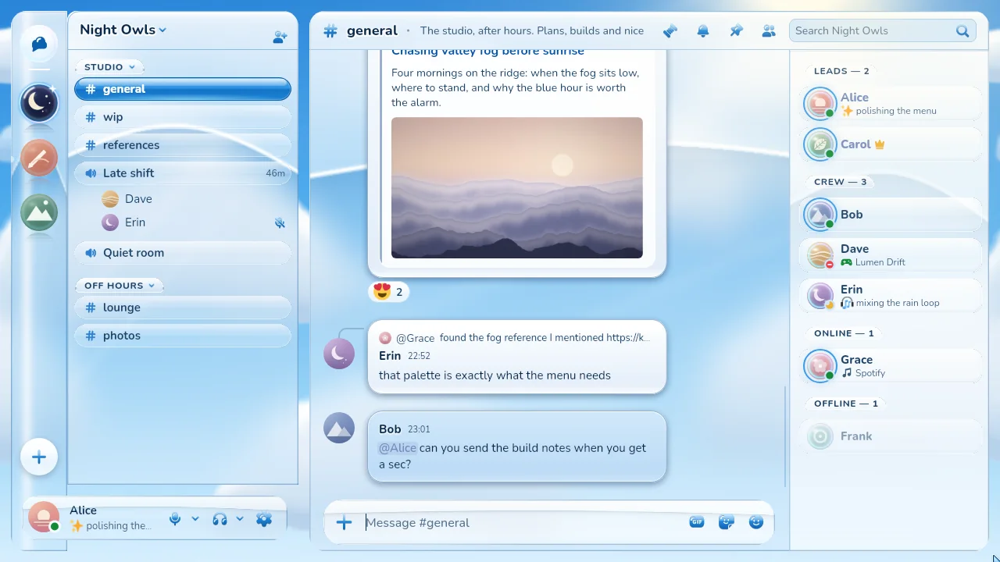
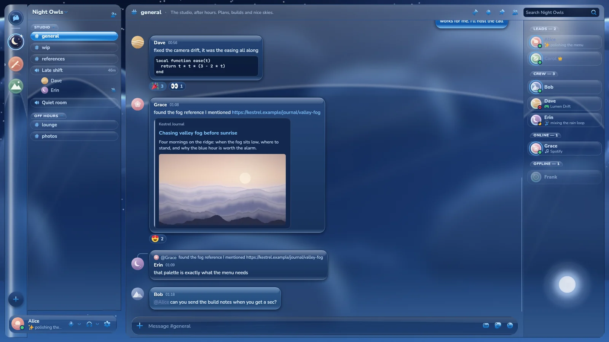

# Daydream

A theme for [Yapfast](https://github.com/yapfast/yapfast).

A Frutiger-Aero daydream: frosted glass panes floating over a sunny sky of drifting cumulus, glossy gel-blue buttons, bubble chat, water-drop sounds and a bubbly icon pack.

It comes as **day** and **night**. Night is a moonlit sky of soft stars and silver-edged clouds behind the same glass, with gel accents that still glow. Daydream follows your system's light or dark windows; to keep one, set **Light or dark** under the theme in **Settings > Appearance**.

## Install

- In Yapfast, open **Settings > Appearance > Themes**, find **Daydream** in the marketplace and install it.
- Or paste this repository's URL (`https://github.com/yapfast-themes/daydream`) into **Settings > Appearance > Themes > Add from URL**.

## Credits

Art, sounds and icons: original work for this theme (CC0). Fonts: Nunito and JetBrains Mono (SIL OFL 1.1).

Full terms are in [LICENSE](LICENSE) (CC0-1.0 AND OFL-1.1); each font's licence sits beside it in `fonts/`.
