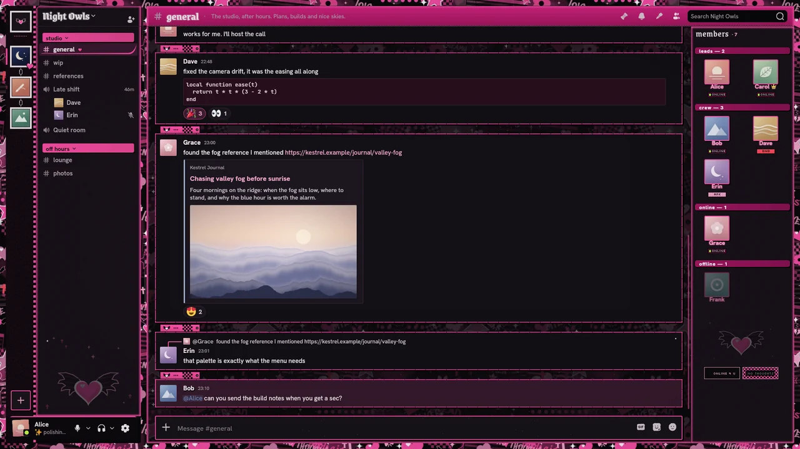

# Eyeliner

A theme for [Yapfast](https://github.com/yapfast/yapfast).

Pink-and-black profile-page era with e-girl finish: boxed modules on a collage of crosses, hearts, bats and bokeh, glowing blackletter, magenta bars, blinkie stamps, a liner highlighter, marker icons and glitter chimes. Dark only.

## Install

- In Yapfast, open **Settings > Appearance > Themes**, find **Eyeliner** in the marketplace and install it.
- Or paste this repository's URL (`https://github.com/yapfast-themes/eyeliner`) into **Settings > Appearance > Themes > Add from URL**.

## Credits

Art and sounds: original work for this theme (CC0). Icons redrawn from Solar by 480 Design (CC BY 4.0) and Lucide (ISC). Fonts: Grenze Gotisch, Hanken Grotesk and JetBrains Mono (SIL OFL 1.1).

Full terms are in [LICENSE](LICENSE) (CC0-1.0 AND OFL-1.1); each font's licence sits beside it in `fonts/`.
