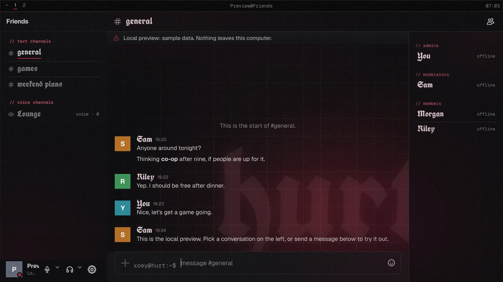

# Hurt

A theme for [Yapfast](https://github.com/yapfast/yapfast).

hurt.bio as a chat app: a near-black room with faint oxblood light and a fading grid, film grain, blackletter names lit red, titles that decrypt, a spinning record for home, sharp icons, vinyl needle-drops and dry clicks. Dark only.

## Install

- In Yapfast, open **Settings > Appearance > Themes**, find **Hurt** in the marketplace and install it.
- Or paste this repository's URL (`https://github.com/yapfast-themes/hurt`) into **Settings > Appearance > Themes > Add from URL**.

## Credits

Palette, fonts and motion follow hurt.bio, with its owner's permission. Art, icons and sounds: original work for this theme (CC0). Fonts: Geist, Geist Mono and Hurt Fraktur, a modified UnifrakturCook (SIL OFL 1.1).

Full terms are in [LICENSE](LICENSE) (CC0-1.0 AND OFL-1.1); each font's licence sits beside it in `fonts/`.
