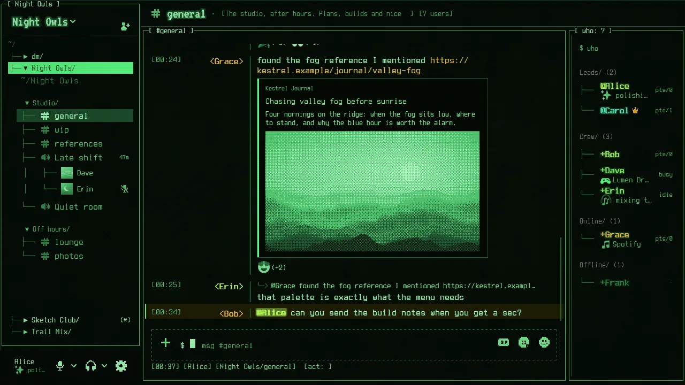

# Phosphor

A theme for [Yapfast](https://github.com/yapfast/yapfast).

A terminal IRC client on warm green phosphor: a timestamped log with a nick column, directory-tree channels, a `$ who` nick list, a block-caret input line, box-drawn panes, a soft glow and a tube that warms up. Pings in amber; pictures dithered in phosphor greens.

## Install

- In Yapfast, open **Settings > Appearance > Themes**, find **Phosphor** in the marketplace and install it.
- Or paste this repository's URL (`https://github.com/yapfast-themes/phosphor`) into **Settings > Appearance > Themes > Add from URL**.

## Credits

Art and sounds: original work for this theme (CC0). Pixel icons adapted from Solar by 480 Design (CC BY 4.0). Fonts: Terminus (TTF) and VT323 (SIL OFL 1.1).

Full terms are in [LICENSE](LICENSE) (CC0-1.0 AND OFL-1.1 AND CC-BY-4.0); each font's licence sits beside it in `fonts/`.
