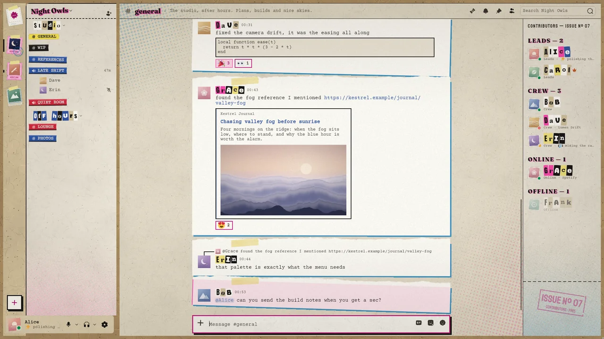
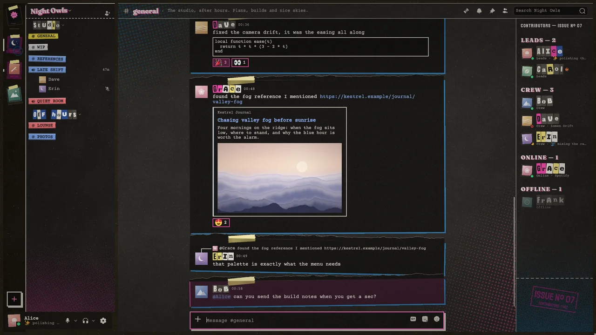

# Zine

A theme for [Yapfast](https://github.com/yapfast/yapfast).

A punk zine off a two-drum risograph: torn, taped scraps pasted crooked with hard riso-blue shadows, ransom-note names from eight typefaces, typewriter text, a masking-tape hover bar, a highlighter that swipes under the pointer, rubber stamps, scissor-cut icons and paper sounds.

It comes in two prints: the light riso run, and an **inverted** run that looks like the same pages through a copier set to black: toner-black scraps with pale torn edges, light ink, the same tape, stamps and pink and blue halftones. It follows your system's light or dark mode; pin one under the theme's **Light or dark** option.

## Install

- In Yapfast, open **Settings > Appearance > Themes**, find **Zine** in the marketplace and install it.
- Or paste this repository's URL (`https://github.com/yapfast-themes/zine`) into **Settings > Appearance > Themes > Add from URL**.

## Credits

Art and sounds: original work for this theme (CC0). Icons re-inked from Solar by 480 Design (CC BY 4.0) and Lucide (ISC). Fonts: Courier Prime, Fraunces, Archivo Black, Staatliches, Anton, Abril Fatface, Bungee, DM Serif Display, Rubik Mono One and Rammetto One (SIL OFL 1.1).

Full terms are in [LICENSE](LICENSE) (CC0-1.0 AND OFL-1.1 AND CC-BY-4.0 AND ISC); each font's licence sits beside it in `fonts/`.
